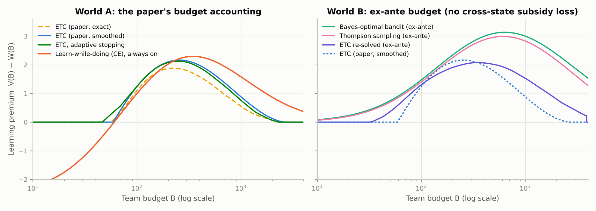
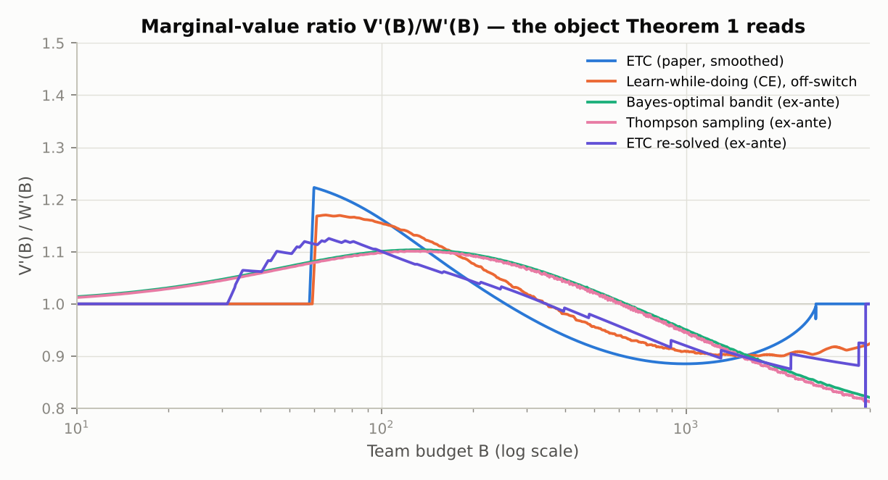
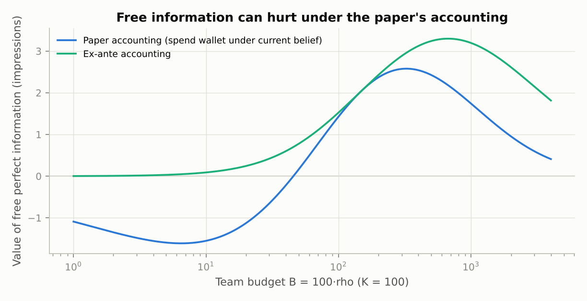
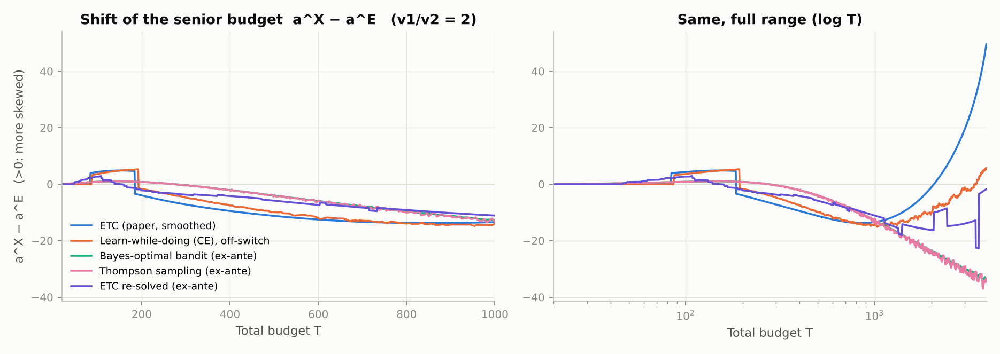
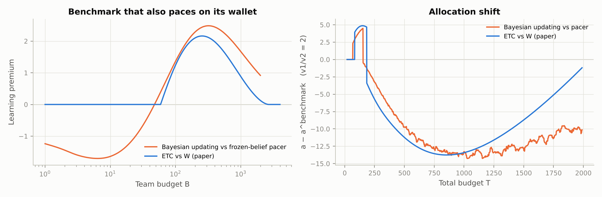
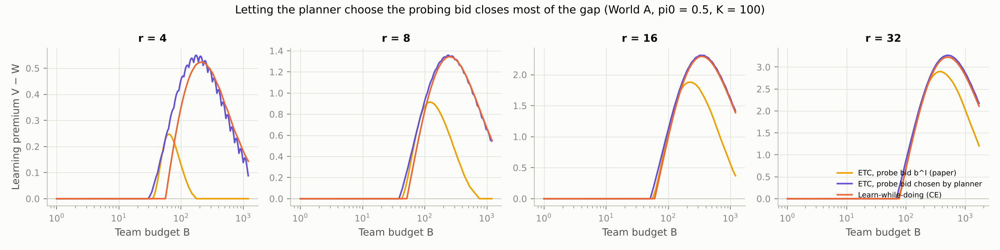
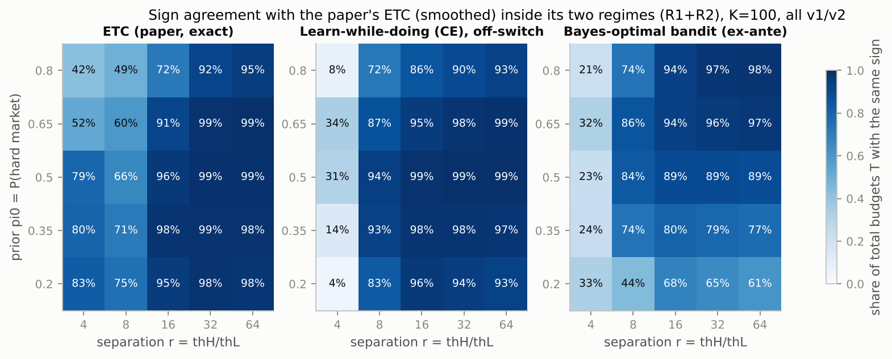
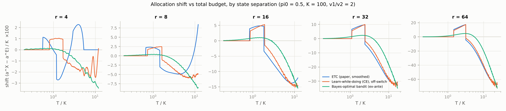
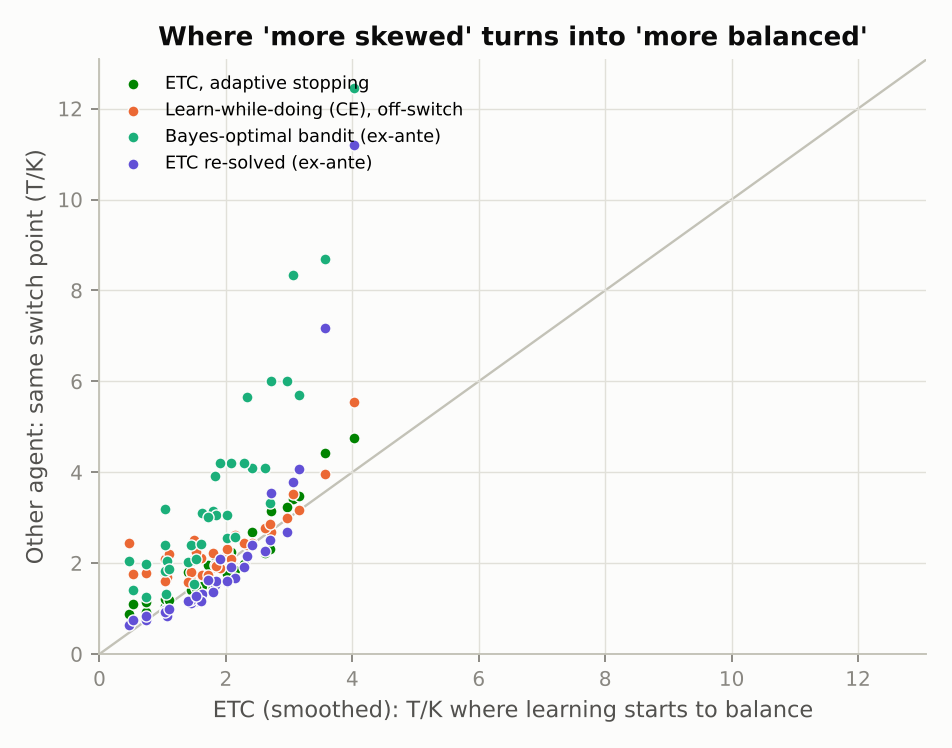

# ETC 团队 vs. Bandit：分配方向的稳健性检验

> 对象：*Orchestrating Agent Teams: Budget Allocation in Real-Time Bidding*（Yang, Zhu & Mookerjee）
> 以 slides 版本为准（smoothed ETC 模型、`summary-table.csv` 中的分配表）。
> 本目录的代码完整复现了论文/slides 中的数字，然后在同一个市场、同一个非学习基准 *W(B)* 下，
> 把"先探测、后利用"（ETC）的团队换成"边做边学"（bandit 式）的 agent，比较分配偏斜（skewness）的变化方向。

---

## 术语（先读这个）

| 简称 | 含义 |
|---|---|
| **ETC** | Explore-Then-Commit（先探索、后承诺），也就是论文里的 agent team：探测 agent 先用固定出价 b^I 探测 τ 期（纯学习），交接后执行 agent 按后验算出一个固定出价执行到底（纯执行，不再学习）。bandit 文献里这类策略就叫 ETC。 |
| **W** | 不学习的基准：按先验出一个固定出价，执行到底。 |
| **边做边学 / CE** | reviewer 说的 bandit 式 agent：没有单独的学习阶段，每次拍卖后都更新信念，每期按当前信念和剩余预算重新算出价（certainty-equivalent，也叫 myopic Bayesian）。 |
| **Bayes-optimal** | 用动态规划求出的最优边做边学策略：每期出价同时考虑"这期能赢多少"和"这期的结果能让我学到多少"。任何 bandit 算法的期望价值都不会超过它。 |
| **Thompson sampling（TS）** | 最常用的实用 bandit 算法：每期从后验里随机抽一个市场状态，假装它是真的来出价。 |
| **学习溢价 V−W** | 能学习的团队比不学习的团队多拿到的期望曝光。 |
| **V′/W′** | 多给一单位预算时，能学习的团队多拿的曝光 ÷ 不学习的团队多拿的曝光。Theorem 1 比较的就是两个团队各自的这个比值。 |
| **a^X − a^E** | 允许学习（方式 X）之后，senior 团队的最优预算比"都不学习时"多（+，更偏斜）还是少（−，更平衡）。 |
| **世界 A / 世界 B** | 两种预算记账方式。A = 论文的方式：每次定计划时，按当时的信念算出的期望花费 = 剩余预算。B = ex-ante：只要求活动开始前看，平均总花费 ≤ 预算（bandits-with-knapsacks 文献常用）。 |
| **r = θ_H/θ_L** | 难市场与容易市场的竞争强度之比；r 越大，两个状态越容易区分。 |
| **R0–R3** | 按论文 ETC 自己的结果给总预算 T 分段：R0 谁都不学；R1 ETC 更偏斜；R2 ETC 更平衡；R3 尾部。 |

---

## 0. 结论速览

1. **同意这个策略，但要换一种论证。** 论文的 Theorem 1 对*任何*学习技术诱导的价值函数 V 都成立：
   分配方向只取决于边际价值比 V′/W′ 在两个预算之间是升还是降。所以要证明的不是"ETC 的价值接近 bandit"
   （它不接近：高预算时差很多），而是"**ETC 推出的 V′/W′ 形状与 bandit 相同**"。"bandit 无法解析"也要说得更准：
   本模型的 Bayes-optimal 策略可以用动态规划精确数值求解（这里就做了），做不到的是闭式比较静态。
2. **在你们的预算会计下，结论对"边做边学"很稳健。** 基准参数下，每次拍卖后更新信念、每期重新 pacing 的
   Bayesian agent 复现了同样的区间：更偏斜 T∈[87, 193)、更平衡 T∈[193, 2880)；ETC 为 [84, 185)、[185, 1940)。
   换成"同样按钱包 pacing、但不更新信念"的基准，分配方向一致率 95%，切换点同为 T≈185。
3. **在哪些参数上一致（K=100 全因子：25 个市场 × 5 个价值比，另做 K=50/200 匹配子集）。**
   在论文强调的两个区间里，边做边学 agent 与 smoothed ETC 的方向一致率为 **92%**（相反符号 4%）——
   和论文自己的 exact ETC 与 smoothed ETC 之间的一致率（91%）一样高。
   关键参数是状态分离度 r=θ_H/θ_L：**r≥16 时 95–96%，r=8 时 87%，r=4 时只有 20%**（此时论文的 exact 与
   smoothed 模型彼此也只有 42–83% 一致）。π₀∈[0.2, 0.8]、v₁/v₂∈[1.25, 4] 和 K 的影响都小（π₀=0.8 时略低，86%）。
   **不一致**集中在三处：区间切换点附近的窄带；**尾部**（slides 中 T=3000 的"再集中"，一致率只有 16%，
   但那里重新分配的价值只有约 0.01 加权曝光，T=100 时是 0.1–0.16）；以及 r=4。
4. **不一致的根源是固定的探测出价 b^I=√(θ_Lθ_H)，可以在 ETC 框架内修正。** 让规划者同时选探测出价
   （仍然是"先纯学习、后纯执行"，w 仍是充分统计量），ETC 的学习溢价在 B≥200 时与边做边学 agent 相差 <0.06，
   r=8 时方向一致率从 48% 升到 81%。这是我最推荐写进论文的扩展。
5. **必须说明的建模选择：预算会计方式。** 学习窗口的下边界主要来自"按当前信念花完钱包"的会计——
   低预算时**连免费的完美信息都会降低价值**（基准下 B<45.5）——所以任何学习协议都有这个下边界；
   但在 ex-ante 会计（bandits-with-knapsacks 文献常用）下它消失。在 ex-ante 会计下 Bayes-optimal、
   myopic Bayesian、Thompson 几乎一样，两段结构仍在（两区间内一致率 82%），但"更偏斜"弱很多（+1 vs +5），切换点后移（基准 T≈275）。
6. **Token allocation：在 orchestrator 层面是好的 proxy，但微观机制要重写。** 同一个预算既买产出又买信息，
   这在 LLM agent 上更明显；但 token 是"不论成败都付费"，会拆掉 RTB 里"花费依赖未知状态"的机制——
   在最简单的映射下信息甚至没有价值——所以学习的价值要来自停止、选方法或再分配；还要处理价值不可加、
   信息共享和多维预算（美元、延迟、上下文窗口）。详见第 6 节。

---

## 1. 对你们论证的评价

**总体同意**：用一个可解析的模型（ETC 团队）推导机制，再用更丰富的模型（bandit / 自适应学习）验证
"关键结论在大部分参数区域不变"，这是标准而且有说服力的做法。实验也支持这个说法（见第 3、4 节）。
但我建议在三个地方修正论证方式，否则 reviewer 仍然可以反驳。

### 1.1 不要说"bandit 太难分析，所以用 ETC"；要说"Theorem 1 与学习协议无关"

论文的 Theorem 1（Direction of reallocation）从头到尾没有用到 ETC 的结构，它对**任何**学习技术诱导的价值函数
*V_X(B)* 都成立：在非学习基准的最优分配 *a^E* 处，

  sign[ d/da (v₁V_X(a) + v₂V_X(T−a)) ] = sign[ ρ_X(a^E) − ρ_X(T−a^E) ],  ρ_X(B) := V_X′(B)/W′(B)。

所以学习协议只通过**边际价值比 ρ_X 的形状**影响分配方向。ETC 的作用不是"近似 bandit 的价值"，而是
"让我们能解析地刻画 ρ 的形状"（学习窗口、进入时的跳跃、交叉偏导恒等式、B̂ 等）。
稳健性检验要回答的问题因此变成：**bandit 的 ρ 是否有同样的形状？**——这正是下面实验检查的东西。

### 1.2 "Bandit 更好"在价值上是对的，但这不是论文的结论对象

Bayes-optimal 的自适应策略按定义弱优于 ETC。基准参数下（θ_L=½, θ_H=8, K=100, π₀=½），学习溢价
*V−W*：

| B | ETC exact | ETC smoothed | 边做边学 CE（论文会计） | Bayes-optimal（ex-ante 会计） | 免费完美信息（论文会计） |
|---:|---:|---:|---:|---:|---:|
| 100 | 1.10 | 1.24 | 1.00 | 1.47 | 1.43 |
| 250 | 1.87 | 2.16 | 2.20 | 2.59 | 2.52 |
| 1000 | 0.55 | 0.88 | 1.58 | 3.00 | 1.74 |

在中等预算下 ETC 拿到了"免费完美信息价值"的 74–87%，高预算下只有 30–50%（因为探测出价 b^I 被压在低位，
放弃了本来买得起的胜利）。（两种会计方式下的数字只作量级参考；同一会计方式下的比较见第 3 节。）
所以 reviewer 说"bandit 价值更高"是对的；但论文问的是**分配方向**，价值占优并不推出方向不同——这一点要在回复里明确说出来。

### 1.3 "Bandit 无法解析"需要说得更精确

在这个模型里（两状态、二元结果），Bayes-optimal 的边做边学策略**可以**用动态规划精确数值求解
（ex-ante 预算下状态只有 (剩余期数, 后验 log-odds)，我们这里就是这么算的）。它做不到的是**闭式**比较静态。
因此更站得住的说法是："ETC 给出闭式的 V 与 V′（二项充分统计量、odds 引理、包络/交叉偏导恒等式），
而自适应最优策略只能数值求解；我们用数值解验证 ETC 推出的方向。"Gittins 指数在这里也不适用
（预算把各期耦合、有限期、连续动作、单一未知状态），这一点 summerpaper 的 related work 已经提到。

### 1.4 ETC 的额外正当性（可以写进回复）

* **制度事实**：平台的 learning phase 是事先配置、按事件计量的（Meta ~50 个优化事件、TikTok、Google），
  广告主控制的是预算和学习阶段，而不是平台内部的探索算法。ETC 正是这种"规划者可以设定学习时长"的结构。
* **两个杠杆**：在 ETC 里规划者同时控制预算和探测时长 τ（slides 的主问题"coordinate budgets and learning durations"）；
  在 bandit 里学习强度是 agent 内部的，不是规划者能协调的杠杆。
* **AI agent 团队的角色分工**：explorer/researcher → executor 的交接（交接的是一个充分统计量 *w*，对应 LLM 团队里的摘要）。
* **文献**：Lizzeri, Shmaya & Yariv (2024, arXiv:2404.19116) "Disentangling Exploration from Exploitation"
  明确论证很多应用中探索与利用不必交织在一起；Guha (2026, arXiv:2610.24156) 研究"有预算的探索先于利用"的 Bayesian bandit；
  Garivier, Lattimore & Kaufmann (2016) 说明 ETC 在 regret 意义下不是最优（reviewer 可能会引用），
  但我们关心的是分配方向而不是 regret。

---

## 2. 实验设计

### 2.1 同一个市场，同一个基准

市场与论文完全相同：θ∈{θ_L, θ_H}，q_θ(b)=b/(b+θ)，赢了付 b，K 期、每期一次拍卖。非学习基准 *W(B)=B/b\*₀,₀* 不变。
代码先复现了论文/slides 的全部关键数字（见 `validate_paper.py`）：

| 量 | 论文/slides | 复现 |
|---|---|---|
| W(57), V(τ=1), V(τ=2) | 43.30105, 43.28944, 43.32796 | 43.30105, 43.28944, 43.32796 |
| exact ETC：B₁、进入时 τ\*、B₂、溢价峰值 | 56、2、~2300、~1.9 | 56、2、2300、1.879（B=225） |
| smoothed：B₁、进入 τ\*、峰值比、B̂、比值最小 | 59、4.7、1.22、256、0.89@990 | 59.5、4.69、1.222、256、0.885@991 |
| 分配 T=150/185/250/400（a^E → a^L） | summary-table.csv | 全部一致到小数点后 3 位 |
| 自适应停止 ETC（draft/DP.tex）门槛、峰值 | 47/48、2.13@250 | 46–47、2.128@250 |

### 2.2 预算会计方式必须固定——这是本次最重要的技术点

论文的会计方式是："每当 agent 承诺一个开环计划时，计划在**当前信念下**的期望花费等于钱包余额"。
W 在 t=0 承诺一次；ETC 承诺两次（t=0 与交接时）。这个会计方式有一个后果：不学习的 agent 会在便宜状态
（θ_L）超支、在昂贵状态（θ_H）少花，等于在两个状态之间做了隐性的交叉补贴；学习会拆掉这个补贴。

因此我们在两个"世界"里分别比较，每个世界内部所有 agent 用同一种会计：

| 世界 | 会计方式 | Agents |
|---|---|---|
| **A（论文的会计）** | 每次（重新）承诺计划时，当前信念下的期望花费 = 真实钱包 | W；ETC exact；ETC smoothed；ETC 自适应停止；**边做边学 CE**（每期用最新后验和真实钱包重新 pacing，规划者可以关掉学习）；先探测再 CE |
| **B（ex-ante 会计）** | 只要求事前期望总花费 ≤ B（bandits-with-knapsacks 常用的 LP/拉格朗日松弛） | W（与论文相同）；**Bayes-optimal 自适应 bandit**（对 (剩余期数, 后验) 做精确 DP）；myopic Bayesian；Thompson sampling；在 ex-ante 会计下重新求解的 ETC |

数值精度：世界 A 的 CE 用 (期数 × 钱包 × log-odds) 网格 DP，网格加密后溢价变化 < 0.003（B≥100）；
世界 B 的 Bayes-optimal 用包络定理 V′(B)=λ 做 Hermite 插值，并用"参数化精确分配"
（v₁λ₁=v₂λ₂）独立校验，两种方法的 shift 相差 < 0.05（`check_worldB_exact.py`）。

---

## 3. 基准参数结果（θ_L=½, θ_H=8, K=100, π₀=½, v₁/v₂=2）

### 3.1 单团队：学习溢价与边际价值比





1. **在论文会计下，边做边学的 agent 也有学习窗口的下边界，而且位置几乎一样。** CE 的溢价在 B<60.4 为负
   （B=20 时 −1.75），所以 planner 会关掉学习；ETC 的下边界是 55.8（exact）/ 59.1（smoothed），
   自适应停止 ETC 是 46.1。
2. **上边界不同。** ETC 的溢价在 B≈2300（exact）/ 2666（smoothed）归零，因为探测出价 b^I=2 在高预算下
   放弃了本来买得起的胜利；CE 不付这个成本，溢价在 B=4000 仍有 0.37。
3. **对会继续学习的 agent，专门的探测阶段几乎没有价值。** "先在 b^I 探测 τ 期、再 CE"的最优 τ 几乎总是 0
   （37 个配置里最大增益 0.0076 个曝光）。ETC 里的 τ 本质上是在替代"exploitation agent 不再更新信念"。
4. **Theorem 1 读取的对象 V′/W′ 在论文会计下几乎同形。** 两者都在进入时向上跳（CE 1.17，ETC 1.22），
   随后单调下降，在 B≈350（ETC 256）穿过 1，在 B≈1000–2000 见底（ETC 991）。
5. **ex-ante 会计（世界 B）。** Bayes-optimal、myopic Bayesian、Thompson 的溢价处处为正，没有下边界；
   峰值更高、更靠右（3.13，B≈633）；V′/W′ 没有跳跃，平滑升到约 1.10（B≈120）后下降。
   myopic Bayesian 与 Bayes-optimal 几乎重合（溢价差 < 0.003）：每个正出价都带信息，
   不存在 Harrison, Keskin & Zeevi (2012) 意义上"不含信息的价格"，所以被动学习已经足够，
   主动探索几乎没有额外价值。这本身也是回复 reviewer 的一个论据：在这个市场里"边做边学"并不比
   "被动更新 + 正常出价"多做什么。

**怎么从 V′/W′ 读出分配方向（Theorem 1 的用法）。** 先算不学习时的最优分配 a^E，再在两个团队的预算处读比值：
senior 处的比值更大 → 钱往 senior 移（更偏斜）；junior 处更大 → 钱往 junior 移（更平衡）。

| T | 预算（junior / senior） | ETC smoothed 的比值 | 边做边学 CE 的比值 | Bayes-opt（世界 B）的比值 | 结果 |
|---:|---|---|---|---|---|
| 150 | 48.4 / 101.6 | 1.000 / 1.160 | 1.000 / 1.153 | 1.071 / 1.101 | junior 还没进入学习窗口 → 都更偏斜（ETC +4.9，CE +4.8，Bayes-opt +1.0） |
| 250 | 81.0 / 169.0 | 1.193 / 1.069 | 1.166 / 1.100 | 1.094 / 1.101 | 两队都在学、比值递减 → ETC −5.7、CE −3.2；Bayes-opt 两处几乎相等 → +0.3 |

### 3.2 为什么下边界与协议无关：在论文会计下，免费信息也可能有害



在论文会计下，不学习的 agent 在便宜状态超支、在昂贵状态少花（ρ=1 时两状态的条件花费率是 1.60 和 0.40，
目标是 1；`draft/DP.tex` 已经指出过）。学习会拆掉这个隐性的跨状态补贴。小预算时每期胜率
g(π;ρ) ≈ √(ρ·m(π))，其中 m(π)=π/θ_H+(1−π)/θ_L 是线性的，所以 g 对（信念, 每期花费）**联合凹**：
任何信息结构（免费或付费、主动或被动）都不能提高价值（Jensen）。数值上，基准参数下 **B<45.5 时连免费的完美信息
都会降低期望曝光**；阈值随 r 上升（π₀=½ 时 r=4, 8, 16, 32, 64 分别为 B<23, 33, 46, 63, 86），随 π₀ 上升而下降
（`results/free_information_threshold.csv`）。在 ex-ante 会计下免费信息永远不会有害（图中绿线）。

数值例子（B=30，K=100，每期预算 0.3）：不知道状态时出价 0.834，在容易市场赢 62.5%、每期花 0.52（超支 73%），
在难市场赢 9.4%、每期只花 0.08，平均正好 0.3，期望曝光 35.98。知道状态后，每个状态都必须恰好花 0.3：
容易市场出价降到 0.565（赢 53.1%），难市场出价升到 1.706（赢 17.6%），期望曝光 35.32——**知道了反而少 0.66**。
原因是同样一块钱在容易市场能买到多得多的曝光（如果每个状态都花 0.3，容易市场每个曝光付 0.565，难市场要付 1.706）。
不知道状态的 agent 用同一个出价，会"自动"把更多的钱花在容易市场；知道状态后，记账方式要求每个状态各自花完预算，这种倾斜就没有了。
B=100 时同样的计算是 50.00 → 51.43，信息又变得有价值。

**结论：学习窗口的下边界主要来自会计方式（再加上探测成本），而不是 ETC 协议。** 这对"对 bandit 稳健"是好消息，
但也必须在论文里写清楚：换成 ex-ante 会计，下边界就消失了。

### 3.3 分配方向（v₁/v₂=2）



senior 预算的偏移 a^X − a^E（正 = 更偏斜）：

| T | ETC exact | ETC smoothed | ETC 自适应停止 | 边做边学 CE（A） | Bayes-opt（B） | Thompson（B） | ETC（B） |
|---:|---:|---:|---:|---:|---:|---:|---:|
| 100 | +3.42 | +4.35 | +3.51 | +3.63 | +0.86 | +0.90 | +2.68 |
| 150 | +4.88 | +4.86 | +4.52 | +4.82 | +1.02 | +1.01 | +0.03 |
| 185 | +0.16 | −3.41 | +0.11 | +5.23 | +0.91 | +0.90 | −1.35 |
| 200 | −2.49 | −3.98 | −0.10 | −1.66 | +0.81 | +0.76 | −2.19 |
| 250 | −6.23 | −5.73 | −4.23 | −3.20 | +0.33 | +0.31 | −3.06 |
| 400 | −10.04 | −9.48 | −9.82 | −7.55 | −2.05 | −2.30 | −4.19 |
| 600 | −11.39 | −12.50 | −13.24 | −11.87 | −5.94 | −5.79 | −7.35 |
| 1000 | −9.37 | −13.42 | −10.85 | −14.09 | −12.77 | −13.50 | −11.10 |
| 2000 | +9.11 | −1.01 | −3.64 | −10.13 | −23.57 | −23.74 | −16.23 |
| 3000 | +14.89 | +19.56 | +23.62 | −1.10 | −29.65 | −29.97 | −13.91 |

区间边界（|shift| < 0.1+0.001T 记为 0）：

| agent | 开始变偏斜 | 偏斜 → 平衡 | 平衡区间结束 → 尾部再集中 |
|---|---:|---:|---:|
| ETC smoothed（slides） | 84 | 185 | 1940 → 2190 |
| ETC exact | 81 | 192 | 1520 → 1670 |
| **边做边学 CE（世界 A）** | **87** | **193** | **2880 → 3650** |
| Bayes-optimal（世界 B） | 26（幅度 < 1） | ≈275 | T≤3900 内不结束 |
| ETC（世界 B） | 47 | 160 | 3560 |

* **世界 A：三个区间、两个切换点几乎重合。** 在 T∈[20, 3900] 上，CE 与 smoothed ETC 的符号一致率为 86%，
  不一致只出现在 (i) 进入点和切换点附近的几个单位（84–86、185–192）以及 (ii) 尾部 T>1940。
  在偏斜区和平衡区内部，偏移的大小也接近（T=150：+4.8 vs +4.9；T=600：−11.9 vs −12.5）。
* **尾部不稳健，但在经济上可以忽略。** T≥1500 时重新分配带来的价值只有 0.000–0.011 加权曝光
  （T=100 时为 0.10–0.16）。论文自己的 exact 与 smoothed 模型在尾部也不一致（再集中分别从 1670 和 2190 开始；
  两者的不一致区间是 81–83、183–191、1520–2180）。
* **世界 B：两个区间仍在，但"更偏斜"很弱（+1 vs +5），切换点后移到 T≈275，而且没有尾部再集中。**
  这里的"更偏斜"不是因为 junior 学不起，而是因为低预算时 V′/W′ 在上升（预算与学习互补，对应论文的交叉偏导恒等式）。

### 3.4 换一个基准：不学习、但也按钱包重新 pacing 的 agent

有人会说：CE 每期按真实钱包重新 pacing，而 W 是开环的，比较里混进了"跟踪钱包"的效应。
所以再做一个对照：基准换成**信念固定在先验、但每期按真实钱包重新 pacing** 的 agent（标准的 pacing 算法），
学习者是在同一 pacing 规则上加 Bayesian 更新（`run_pacer_benchmark.py`）。



* Bayesian 更新相对这个基准的价值在 B<47.7 时仍为负——下边界依然存在。
* 分配偏移的符号与论文 ETC 一致的比例为 **95%**（T∈[20, 1990]，相反符号只有 1.6%），
  偏斜→平衡的切换点同样在 **T≈185**（T=150：+4.4 vs +4.9；T=600：−11.5 vs −12.5）。

### 3.5 不一致的根源：固定的探测出价 b^I，以及一个简单的修正

ETC 的探测出价固定为 b^I=√(θ_Lθ_H)，与预算无关。预算大时 exploitation 出价远高于 b^I，探测意味着放弃大量买得起的胜利，
所以 ETC 的溢价比边做边学的 agent 更早归零——这就是上边界和尾部差异的来源；状态差异小（r=4）时 b^I 更低，问题出现得更早。

**修正：让规划者同时选择探测出价 b_p 和时长 τ。** 这仍然是"先纯学习、后纯执行"的结构，w 仍然是充分统计量
（只是赢/输的对数似然步长不再对称），所以论文的解析框架可以保留（论文 slides 的 note 里也提到"jointly optimizing a
constant learning bid and duration is an extension"）。结果（`run_optbid.py`，世界 A，π₀=½，K=100）：



| r | 学习溢价峰值：ETC（b^I） | ETC（规划者选 b_p） | 边做边学 CE | 与 CE 的符号一致率：ETC（b^I） → ETC（选 b_p） |
|---:|---:|---:|---:|---:|
| 4 | 0.25 @ B=64 | 0.55 @ 174 | 0.52 @ 212 | 18% → 57% |
| 8 | 0.91 @ 120 | 1.36 @ 239 | 1.34 @ 252 | 48% → 81% |
| 16 | 1.88 @ 224 | 2.31 @ 330 | 2.29 @ 348 | 99% → 97%（T≤1200） |
| 32 | 2.90 @ 373 | 3.27 @ 502 | 3.23 @ 503 | 99% → 98%（T≤1697） |

（符号一致率在 T∈[0.2K, 12K·max(1,√(θ_H/8))] 上计算；r≥16 时这个范围还没进入尾部，所以两种 ETC 都几乎完全一致。）
最优探测出价随预算上升（r=16 时 B=400 对应 b_p≈5.7，而 b^I=2），B≥200 时两者的溢价相差不到 0.06。
剩下的差异集中在进入点附近：ETC 能"先少量探测、再停止学习"，比被动学习者更早开始赚钱（r=4 时 B=60：0.26 vs 0.05）。

---

## 4. 参数扫描：分配方向在哪些参数上一致？

**设定。** θ_L=½（只有 r=θ_H/θ_L 和以 θ_L 为单位的预算重要）。K=100 时 θ_H∈{2, 4, 8, 16, 32}（r=4–64）×
π₀∈{0.2, 0.35, 0.5, 0.65, 0.8}；另外 K=50 时 θ_H∈{4, 8, 16} × π₀∈{0.35, 0.5, 0.65}，K=200 时 θ_H=8 × π₀∈{0.35, 0.5, 0.65}
（论文已经表明结果按 B/K 缩放，所以 K=200 只做匹配子集）。每个配置取 v₁/v₂∈{1.25, 1.5, 2, 3, 4}，
总预算 T 从 0.2K 到 12K·max(1, √(θ_H/8))，步长 K/100。对每个 T 计算 a^X − a^E，|shift| < 0.1+0.001T 记为 0。

**按 ETC（smoothed，slides 版本）自己的区间分类**，因为固定的 T/K 区间会把不同 r 下的区间混在一起：
R0 = 谁都不学（低 T）；R1 = ETC "更偏斜"；R2 = ETC "更平衡"；R3 = 尾部（ETC 最后一个"更平衡"的 T 之后：再集中或不再学习）。
论文强调的两个结论都在 R1+R2 里。

### 4.1 按区间的一致率（K=100 全因子，参照 = smoothed ETC；"同号 / 反号"，其余为一方 ≈0）

| 区间 | ETC exact | ETC 自适应停止 | **边做边学 CE（A）** | Bayes-opt（B） | Thompson（B） | ETC（B） |
|---|---:|---:|---:|---:|---:|---:|
| R0 谁都不学 | 0.98 / 0.00 | 0.80 / 0.00 | 0.98 / 0.00 | 0.36 / 0.00 | 0.36 / 0.00 | 0.58 / 0.00 |
| R1 ETC 更偏斜 | 0.90 / 0.00 | 0.81 / 0.10 | **0.83 / 0.00** | 0.86 / 0.01 | 0.86 / 0.01 | 0.74 / 0.13 |
| R2 ETC 更平衡 | 0.91 / 0.04 | 0.95 / 0.03 | **0.93 / 0.04** | 0.81 / 0.10 | 0.82 / 0.10 | 0.91 / 0.04 |
| **R1+R2（论文的两个结论）** | 0.91 / 0.04 | 0.94 / 0.03 | **0.92 / 0.04** | 0.82 / 0.09 | 0.82 / 0.09 | 0.89 / 0.05 |
| R3 尾部 | 0.73 / 0.00 | 0.74 / 0.02 | 0.16 / 0.36 | 0.13 / 0.36 | 0.12 / 0.36 | 0.64 / 0.09 |

（T 点数：R0 8,398；R1 13,634；R2 131,994；R3 36,024。世界 B 在 R0 的"不一致"是因为 ex-ante 会计下学习在任何预算都略有价值，偏移很小但不为零。）

**读法：** 在论文的两个结论所在的区间里，边做边学 agent 与 slides 版 ETC 的方向一致率（92%）和论文自己的
exact ETC 与 smoothed ETC 之间的一致率（91%）一样高——也就是说，"换成 bandit"带来的差异不比"换一种 ETC 近似"更大。
反号只有 4%，而且集中在切换点附近。尾部是唯一系统性不一致的地方。

### 4.2 哪些参数上一致（R1+R2 一致率，K=100）

| 参数 | 取值 → 边做边学 CE（世界 A） | 取值 → Bayes-opt（世界 B） | 对照：ETC exact vs smoothed |
|---|---|---|---|
| r=θ_H/θ_L | 4: **0.20**；8: 0.87；16: 0.95；32: 0.96；64: 0.96 | 4: 0.27；8: 0.75；16: 0.85；32: 0.86；64: 0.85 | 4: 0.64；8: 0.64；16: 0.90；32: 0.97；64: 0.98 |
| π₀ | 0.2: 0.91；0.35: 0.95；0.5: 0.96；0.65: 0.94；0.8: 0.86 | 0.2: 0.61；0.35: 0.76；0.5: 0.86；0.65: 0.92；0.8: 0.92 | 0.2: 0.95；…；0.8: 0.83 |
| v₁/v₂ | 1.25: 0.92；1.5: 0.94；2: 0.94；3: 0.92；4: 0.90 | 1.25: 0.76 → 4: 0.85 | 0.87 → 0.93 |
| K（匹配子集 θ_H=8, π₀∈{.35,.5,.65}） | 50: 0.93；100: 0.97；200: 0.98 | 50: 0.88；100: 0.88；200: 0.87 | 50: 0.84；100: 0.95；200: 0.99 |







**总结"在哪些参数上一致"：**

* **一致**：r≥8（r≥16 时几乎完全一致），π₀∈[0.2, 0.65]，任意 v₁/v₂∈[1.25, 4]，任意 K（按 B/K 缩放），
  在 ETC 的"更偏斜"和"更平衡"两个区间内。切换点（偏斜→平衡）的位置也基本重合（上图橙点贴着对角线；
  例如 r=16, π₀=½：T/K=1.85 vs 1.93；r=64, π₀=½：3.16 vs 3.17）。
* **较弱**：π₀=0.8（86%）。π₀ 高时 ETC 的进入是连续的（没有跳跃），"更偏斜"区间很窄，切换点对协议更敏感。
* **不一致**：(i) r=4——固定探测出价 b^I=1 太低，ETC 的学习溢价只是低预算处的一个窄峰，形状与 bandit 完全不同
  （此时连论文自己的 exact 与 smoothed 模型也只有 64% 一致）；(ii) 尾部 R3——ETC 的溢价因探测成本在大预算下归零，
  被动学习者没有这个成本；(iii) 切换点附近的窄带。
* **世界 B（ex-ante 会计）**：方向一致率 82%，但切换点系统性地更晚（上图绿点在对角线上方），
  π₀ 低时尤其明显（π₀=0.2：61%）。这说明**会计方式对结论的影响比学习协议更大**。

---

## 5. 建议如何写进论文 / rebuttal

### 5.1 建议的论文修改

1. **把 Theorem 1 明确表述为与学习协议无关**（"for any learning technology with value function *V*"），
   并说明 ETC 的作用是让 *V′/W′* 的形状可以闭式刻画。
2. **新增附录 "Learning while exploiting"**：放第 3 节的三张图（溢价、*V′/W′*、shift）和第 4 节的一致率表。
3. **把"学习窗口下边界"的解释改成两个来源**：探测成本（slides 的 "too poor to fund probes"）
   *和* 会计方式造成的"免费信息有害"（`draft/DP.tex` 里其实已经写过 cross-state subsidy）。
   后者是一个很好的经济学结论——"对一个按当前信念 pacing 的 agent，信息有隐性成本：它拆掉了跨状态的补贴"——
   而且它恰好解释了为什么下边界与协议无关。同时要为这种会计方式辩护（平台的 pacing 是按当前估计
   重新瞄准剩余预算，而不是事先承诺在某些状态超支），并承认在 ex-ante 会计下下边界会消失。
4. **远尾部（T=3000 那张 slide，"More skewed: Both teams learn"）要降级**：它来自 ETC 探测出价 *b^I*
   在高预算下的成本，边做边学的 agent 要到更大的 T 才出现（世界 A）或根本不出现（世界 B）；
   连论文自己的 exact 和 smoothed 模型在尾部的切换点都不一致（再集中分别从约 1670 和 2190 开始）。
   Takeaway 3 建议改成"方向由 *V′/W′* 在两个预算之间是升还是降决定"，不要强调尾部例子。

### 5.2 回复 reviewer 的英文段落（草稿，数字来自本目录的实验）

> *Why separate learning from exploitation instead of using a bandit?* We agree that a policy that learns while it
> exploits weakly dominates our learn-then-exploit protocol in value. Our allocation results, however, do not hinge
> on this separation. Theorem 1 is protocol-free: for any learning technology with value function *V_X*, the local
> direction in which learning moves the optimal split is the sign of *V_X′(a^E)/W′(a^E) − V_X′(T−a^E)/W′(T−a^E)*,
> and under the theorem's concavity condition this sign gives the direction of the optimal reallocation.
> The learning protocol matters only through the shape of this marginal-value ratio, and the role of the
> learn-then-exploit structure is to characterize that shape in closed form. To verify that the shape—and hence the
> direction of reallocation—survives when agents learn and exploit simultaneously, we re-solve the model holding the
> market and the no-learning benchmark fixed, with (i) a Bayesian agent that updates after every auction and re-paces
> its remaining budget, (ii) the Bayes-optimal adaptive policy computed by dynamic programming over (periods remaining,
> posterior), and (iii) Thompson sampling. Under our budget accounting, the learn-while-exploiting agent reproduces
> the lower edge of the learning window (its premium turns positive at B≈60 versus 56–59 under ETC), the upward jump
> of V′/W′ at entry and its subsequent decline, and hence both allocation regimes: at the baseline calibration
> learning makes the split more skewed for T∈[87,193) and more balanced for T∈[193,2880), compared with [84,185) and
> [185,1940) under ETC. Against a no-learning benchmark that also re-paces on its realized budget, the sign of the
> reallocation coincides with our ETC result for 95% of total budgets up to T=2000 and switches at the same total
> (T≈185). Across 25 market configurations (θ_H/θ_L from 4 to 64, prior from 0.2 to 0.8) and five value ratios,
> the sign coincides for 92% of total budgets within the two regimes emphasized in the paper—as often as our exact
> and smoothed ETC models agree with each other (91%)—and for 95–96% when θ_H/θ_L≥16; results are unchanged across
> horizons K∈{50,100,200}. Disagreements concentrate in narrow bands around regime switches, in the far tail of
> very large budgets (where reallocation is worth about 0.01 weighted impressions or less), and in markets whose states are
> poorly separated (θ_H/θ_L=4), where the fixed probing bid √(θ_Lθ_H) makes dedicated probing expensive relative to
> passive learning. Letting the planner choose the probing bid as well as the probing length—which preserves the
> learn-then-exploit structure and the sufficiency of the win count—brings the ETC learning premium within 0.06
> impressions of the learn-while-exploiting agent at every budget above 200. Finally, the lower edge of the learning
> window is not specific to our protocol: when an agent paces its remaining budget under its current belief, even
> free information lowers expected impressions at small budgets, because the uninformed agent implicitly
> cross-subsidizes spending across market states.

（数字都可以在本目录复现。英文段落是草稿，措辞请按论文最终版本调整；"25 market configurations"指 K=100 全因子。）

---

## 6. "最优资源分配 = token 分配"是不是好的 proxy？

**我的判断：在规划者（orchestrator）层面是一个好的 proxy；在单个 agent 的微观层面，模型必须改，
而且要改的恰好是产生你们"学习窗口下边界"的那个机制。**

### 6.1 为什么说它是好的 proxy

1. **同一个决策结构**：orchestrator 事先把一个同质、可分的预算（token / 美元）分给若干 sub-agent，
   sub-agent 不能被重新训练、只能被配置——这正是论文里 planner 的问题。
2. **预算的双重用途在 LLM agent 上更明显**：读文件、搜索、跑测试、调用工具是"探索"，
   写代码/写答案是"利用"，两者花的是同一个 token 预算。"Each unit of budget is simultaneously output and tuition"
   几乎可以原样搬过去；planner/researcher/executor 的角色分工也对应 ETC 的"探测 agent → 利用 agent"交接。
3. **有经验证据说 token 是主要生产要素**：Anthropic 在介绍其多 agent research system 的工程文章（2025）中报告，
   在 BrowseComp 上 token 用量单独解释了约 80% 的表现方差（另外两个因素是工具调用次数和模型选择），
   多 agent 系统消耗的 token 约为普通对话的 15 倍。（引用前请再核对原文数字。）
4. **可以做实验**：token 预算能在实验里精确控制，所以可以直接测 *V(B)*、关掉探索阶段测 *W(B)*，
   再估计 *V′/W′*，检验 Theorem 1 的方向预测。这是把论文从 RTB 推广到 AI agent 最有价值的地方。
   近期也有不少相关工作在研究"预算感知"的 agent（如 arXiv:2610.28409、2610.27119、2609.15309、2610.23246），
   但它们大多是单 agent 或工程视角，"跨多个会学习的 sub-agent 分配预算"这个经济学问题仍然空着。

### 6.2 必须修改的地方（按重要性）

1. **成本结构：pay-per-win → pay-per-attempt。** RTB 里只有赢了才付钱，所以花费 *b·q_θ(b)* 依赖未知状态 θ——
   这正是第 3 节"交叉补贴、免费信息有害、学习窗口下边界"的来源。LLM 的 token 不管成败都要付，
   花费不依赖 θ，这个机制就消失了。更进一步：如果把出价 *b* 直接换成"每步 token 数"、成功率 *b/(b+θ)*，
   在 all-pay 下最优的每步 token 数是 *B/K*，与 θ 无关——信息价值为零。
   所以 AI 版本里学习的价值必须来自别的渠道：**何时停止/放弃**（成功即终止，省下的预算可以回收给别的 agent）、
   **选哪种方法/工具**（离散 bandit）、**在子任务之间再分配**。微观模型需要重写。
   （一个细节：实际中 token 消耗往往*也*依赖难度——难任务推理更长、报错日志更长——
   所以"花费依赖未知状态"在 AI agent 里可能以另一种形式回来，值得单独建模。）
2. **团队价值不可加**：论文的 planner 目标是 *v₁V₁ + v₂V₂*；AI 团队的产出往往是互补/weakest-link 的
   （一个子任务失败，整个任务失败）。互补性会在 Theorem 1 的一阶条件里加入交叉项。
3. **信息是公共品**：LLM 团队共享上下文/记忆，一个 agent 的探索可以被其他 agent 使用。
   论文结论里已经提到同一市场内共享信息的扩展；在 AI 团队里这可能是主效应，问题变成"谁替大家去探索"。
4. **预算不止一维**：美元成本（不同模型每 token 价格可差一个数量级，input/output/cached 价格不同）、延迟、
   上下文窗口、速率限制。只有在同一个模型、成本主要由 token 决定时，token 才是合适的单位；
   更一般的说法是 *compute / cost budget*。上下文窗口还意味着交接是**有损摘要**，不是 *w* 这样的充分统计量。
5. **异质 agent 是 ETC 结构的卖点**：探索可以交给便宜的小模型、利用交给贵的大模型。
   角色分离允许两种技术不同，而单个 bandit agent 做不到——这可以成为 AI 版本里支持"分开学习与执行"的理由，
   比"bandit 难分析"更有说服力。

### 6.3 一个可执行的研究设计

两条任务流（价值 *v₁ > v₂*，例如高/低优先级的代码修复任务），每条由一个 sub-agent 处理；
orchestrator 分配 token 预算 *(a, T−a)*，并可以给每个 sub-agent 打开一个预算为 τ 的探索阶段
（先跑测试/读代码/用小模型估计难度，再执行）。对每个 *B* 测成功率，得到 *V(B)*（有探索）和 *W(B)*（无探索），
估计 *V′/W′* 的形状，检验：(i) 是否存在学习窗口；(ii) 打开探索后最优分配是否按 Theorem 1 的方向移动。

---

## 7. 复现

```bash
python -m venv .venv && .venv/bin/pip install numpy scipy matplotlib numba
cd bandit_check
../.venv/bin/python validate_paper.py      # 复现论文数字（~10 s）
../.venv/bin/python run_baseline.py        # 基准参数下的全部 agent（~6 min）
../.venv/bin/python run_vpi.py             # 免费信息的价值（两种会计）
../.venv/bin/python check_worldB_exact.py  # 世界 B 的参数化精确分配校验
../.venv/bin/python run_pacer_benchmark.py # 换成"按钱包 pacing 的不学习基准"（~2 min）
../.venv/bin/python run_optbid.py          # 规划者同时选择探测出价的 ETC（~5 min，需先跑 run_sweep 的缓存）
../.venv/bin/python run_sweep.py           # 37 个市场配置 × 5 个价值比（约 1 小时，结果缓存在 results/cache）
../.venv/bin/python summarize_sweep.py     # 汇总表与图
../.venv/bin/python run_large_K.py         # 命题 1-2 的数值验证：K=50…400 与大 K 极限（~4 min）
```

| 文件 | 内容 |
|---|---|
| `core.py` | 论文模型：pacing、W、exact ETC、smoothed ETC、自适应停止 ETC、规划者选择探测出价的 ETC |
| `bandits.py` | 世界 A 的边做边学 CE（网格 DP）；世界 B 的 Bayes-optimal / myopic / Thompson / ETC（拉格朗日 DP） |
| `agents.py` | 在统一预算网格上计算所有 agent 的 V(B) |
| `allocation.py`, `analysis.py` | 两团队分配、边际价值比、符号一致率 |
| `results/baseline_*` | 基准参数：日志、shift、`baseline_summary.json`（溢价、边界、再分配价值） |
| `results/sweep_summary.txt`, `results/sweep_regime_agreement.csv` | 扫描结果：按区间、按参数的一致率；每个配置 × 价值比 × agent × 区间一行 |
| `results/*.png` | 本文所有图 |
| `limit_theory.py`, `run_large_K.py` | 大 K 极限对象（VPI、Ψ、凹包络 Φ、信念曲率）与 K=400 验证 |
| `results/large_K/` | 验证结果：`summary.txt`（所有阈值、收敛表、学习成本、τ*、分配切换点）与收敛图；命题与证明见 [`../theory/large_horizon_limit.pdf`](../theory/large_horizon_limit.pdf) |

**局限。** (1) 世界 A 里的边做边学 agent 是 certainty-equivalent（每期按当前后验做最优开环 pacing），
不是在论文会计下"完全前瞻"的最优策略——在论文会计下每个历史都重新承诺，会把它变成近似硬预算问题，
与 W 不可比；世界 B 中 myopic 与 Bayes-optimal 几乎相同，说明这个近似损失很小。(2) 没有做"硬预算"（逐路径不超支）
的版本：硬预算下"不学习"的基准本身就会根据花费速度调整，等于隐性学习，没有一个干净的对照；3.4 节的 pacer 基准是最接近的替代。
(3) 只有两个市场状态和两个团队；论文结论部分提到的多团队、同一市场内共享信息的情形没有测试。
